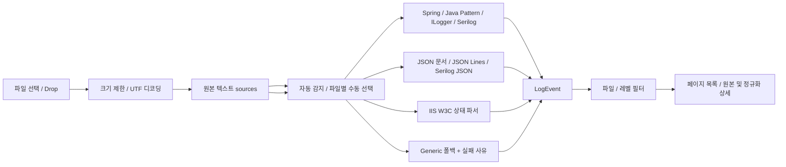
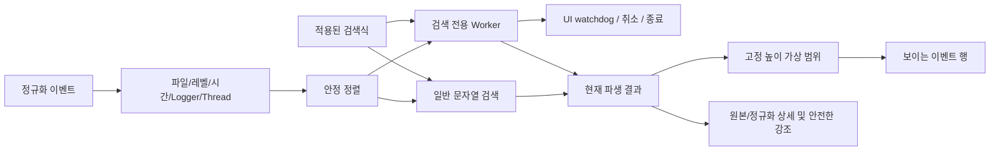
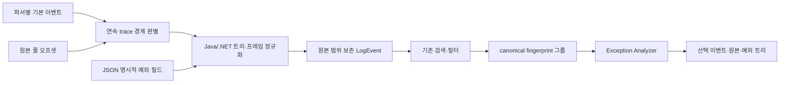
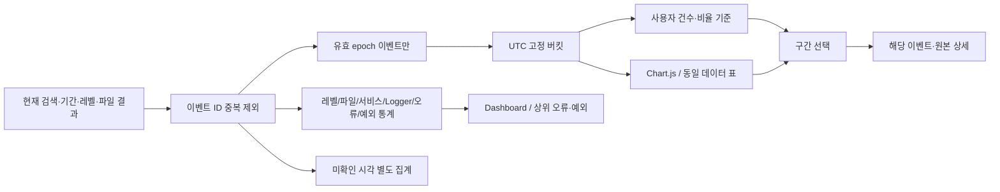
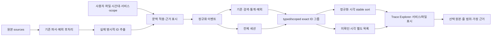

> Phase 1~6 설명은 당시 설계 이력입니다. 현재 파싱/원본 수명과 한도는 Phase 7 절, UI/내보내기는 Phase 8 절을 기준으로 합니다.

# 파싱 및 검색 아키텍처

src/core/parsing은 React와 I/O를 참조하지 않는다. common.ts는 원본 행 위치·레벨 별칭·시간 검증을 공유한다. text.ts/json.ts/iis.ts는 형식별 규칙을 갖고 src/core/parsers.ts가 디스패치한다. 자동 모드는 유효 JSON 문서를 먼저 판별한 뒤, 그 외 입력은 행별 명시적 패턴을 순서대로 적용한다. IIS의 컬럼 상태와 ILogger 헤더/첫 메시지 경계를 처리한 뒤 Phase 4 공통 예외 후처리로 확장한다.

Zustand는 decoded original sources와 normalized events를 분리한다. 파일 선택 시 원본으로 재분석해 해당 파일 결과를 교체한다. 읽기 완료 순서가 달라도 파일 등록 순서를 유지한다. 파일 제거/초기화는 두 저장소를 모두 비운다. 사용자 로그를 외부로 전송하는 요청과 브라우저 영구 저장은 없다. 샘플 fetch는 정적 샘플을 읽기만 한다.

JSON 배열의 각 값은 원문 문자 범위를 스캔해 재직렬화 없이 잘라낸다. ID에 문자 오프셋을 포함해 같은 줄의 여러 객체를 구분하며 줄 번호는 원문 위치로 계산한다. JSON 배열 구분자와 IIS 지시문은 원본 저장소에 남지만 이벤트 건수에는 포함하지 않는다. 잘못된 지시문은 진단 가능한 실패 이벤트로 보존한다.

Phase 2 시점에 남겨둔 검색·가상 스크롤은 아래 Phase 3 경로로 확장했다. 예외 fingerprint는 아래 Phase 4 경로로 확장했고 파싱 Worker·추적 엔진은 후속 Phase다. 현재 파일당 2 MiB·세션당 8 MiB 보호 한도를 유지한다. 원본 텍스트와 이벤트 rawText를 함께 보관하므로 실제 메모리 사용량은 파일 바이트 합보다 크다.

## Phase 3 검색 경로

검색 구현은 src/core/search.ts, 기간/정렬은 filter.ts, Worker 수명주기는 regex-client.ts, React 파생 결과 수명은 useExplorerSearch.ts로 분리한다. 임의 정규식은 검색 Worker 외부에서 실행하지 않는다. 파일 파서/원본 저장소는 변경하지 않았으며 검색 결과는 저장·전송하지 않는다. 일반 검색과 필터/정렬은 현재 메인 스레드에서 수행한다. Phase 7 파싱 Worker와 스트리밍 전환은 아직 미구현이다.

## Phase 4 예외 경로

src/core/exceptions/stack.ts는 선언/프레임/트리와 구조화 필드 분석, merge.ts는 파일별 이벤트 경계와 원문 slice, groups.ts는 보수적 fingerprint 및 관측 통계를 담당한다. UI는 원본/분석 저장소를 수정하지 않는다. 예외 그룹은 별도 영구 상태를 만들지 않고 현재 필터 결과에서 파생한다. 파일 파싱과 그룹 계산은 아직 메인 스레드이며 Phase 7 스트리밍/Worker 최적화와 구분한다.

## Phase 5 통계 경로

statistics.ts는 순수 집계·버킷·구간 함수, statistics-chart.ts는 수치→차트 데이터 변환이다. StatisticsDashboard는 동일 데이터를 Dashboard/Timeline으로 표시하고 StatisticsCharts는 필요한 Chart.js 구성만 등록한다. 외부 로그 요청과 저장은 없다. 기존 파서·원본 저장소·검색 Worker는 변경하지 않았다. 필터 결과 참조가 바뀔 때 계산하며 원본 선택만으로 전체 통계를 재계산하지 않는다. 메인 스레드 집계/파싱의 대용량 최적화는 Phase 7이다.

## Phase 6 파일 문맥과 요청 추적

file-context.ts는 로그/형식/사용자 설정의 근거와 Temporal 시간 해석을 분리한다. correlation/identifiers.ts는 명시적 키만 읽고 trace.ts는 typed/scoped 그룹과 관측 시간 목록을 만든다. SourceFile 설정을 보존한 재파싱이므로 ID/원본 위치는 바뀌지 않으며 파일 제거/초기화가 모든 파생 결과에 반영된다. 별도 원격 API/영구 저장은 없다. 통계는 파일 설정으로 해석된 epoch도 포함하지만 UTC 버킷 정책은 그대로다. 파싱/그룹 계산 Worker와 번들 분할은 Phase 7에서 수행한다.

## Phase 7 파싱 및 원본 수명

UI → workspace.upload/reparse → 단일 활성 파싱 큐 → parse.worker → parseBlob으로 전달한다. parseBlob은 stream-reader 사전 스캔 후 StreamTextParser 또는 JsonDocumentStream을 사용한다. finalizeEvent는 기존 식별자/파일 문맥을 적용한다. 공통 기준 파서는 테스트 비교용이며 제품 UI가 동기 파싱을 호출하지 않는다.

원본 Blob은 별도 Map, 작은 디코딩 캐시는 sources, 정규화 이벤트는 events에 둔다. Worker 결과 성공 시 이벤트/설정/진단을 함께 바꾸고 실패나 취소에서는 기존 완료 결과를 유지한다. reset/remove는 작업 토큰과 원본 참조를 정리한다. 미리보기는 최대 512 KiB다. 진행률은 단계별 바이트 기준이다. 자원 한도와 Node 실측은 PERFORMANCE.md에 기록한다. 필터/통계/추적은 메인 스레드의 파생 메모이제이션을 유지한다.

## Phase 8 UI/로컬 내보내기

ui.ts의 메모리 상태가 data-theme CSS 변수와 Chart.js 팔레트, 상세 너비를 제어한다. workspace의 원본/분석 데이터는 바꾸지 않는다. 모바일은 단일 열과 스크롤 가능한 메뉴를 사용한다. 가상 목록의 키보드 이동은 실제 viewport 높이를 반영한다.

ExportControls → 범위별 ExportDataset builder → serializeExport → downloadArtifact 경로다. 메타데이터/정규화 행/요약을 구분하며 기존 통계·예외·typed trace 함수를 재사용한다. 공통 필터/명시적 전체/선택 이벤트·식별자/버킷 크기를 export context에 남긴다. 원본 File/Blob을 직렬화하거나 서버에 전송하지 않는다.

serializeExport는 JSON/CSV/HTML을 바이트 청크로 모으며 원본 이벤트 50,000개·UTF-8 32 MiB 한도를 적용한다. CSV 방어 접두사는 CSV에만 적용하고 HTML은 동적 값을 escape한다. 진행 행 수와 AbortSignal을 사용하며 revision 변경 시 늦은 결과를 버린다. 파일 다운로드 후 임시 anchor와 object URL을 정리한다. 메인 데이터 준비/레코드 직렬화의 지연은 남아 있다. ADR-026~028에 범위·한계·보안 정책을 기록한다.
